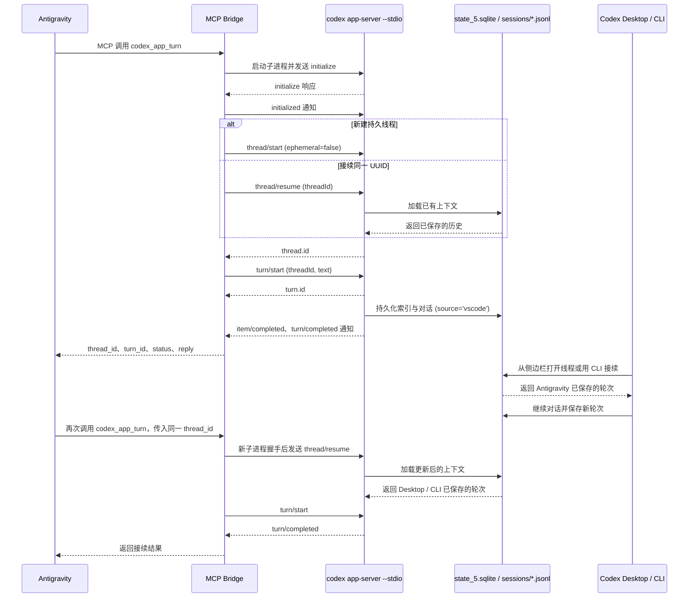
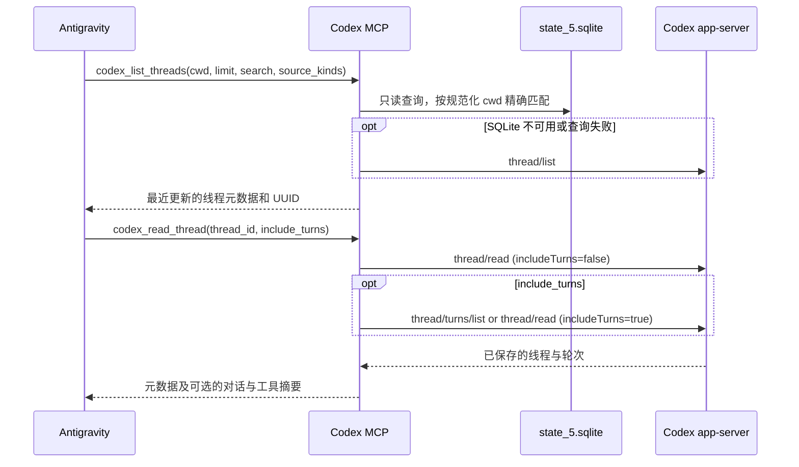

[English](./docs/README_EN.md) | 简体中文

# Antigravity Codex Bridge

让 Antigravity 负责拆解需求、派发任务和验收，让 Codex 在同一个工作区完成工程任务。Bridge 通过 MCP 派发单轮任务，也能查找、读取并接续 Codex Desktop 或 CLI 中的独立对话。

<picture>
  <source media="(prefers-color-scheme: dark)" srcset="./docs/images/architecture.svg">
  <source media="(prefers-color-scheme: light)" srcset="./docs/images/architecture.light.svg">
  
</picture>

## 核心特性

- **任务委派**：Antigravity 通过 MCP 在指定工作目录派发任务，可按任务选择沙箱权限。
- **双向接续**：用同一个线程 UUID 在 Antigravity、Codex Desktop 和 CLI 间轮流继续对话。
- **历史检索**：按目录、标题或来源筛选线程，并读取已保存的对话与工具调用摘要。
- **兼容上游**：保留基于 `codex exec` 的 `codex` 工具及其 `SESSION_ID` 接续方式。

## 快速安装与 Antigravity 插件接入

需要 Python 3.12+、支持 App Server 的 Codex CLI，以及已配置的 Codex 登录或模型提供方。通常通过 PATH 查找 `codex`。在 Windows 上，启动器也会尝试查找 Codex Desktop 自带的 `codex.exe`。

```powershell
git clone https://github.com/khusdasz-cmd/antigravity-codex-bridge.git
cd antigravity-codex-bridge
python -m pip install .
agy plugin validate ./plugin
agy plugin install ./plugin
```

使用 Antigravity CLI（`agy`）验证并安装本地插件，然后新建 Antigravity 会话以加载 MCP。插件加载器会将配置中的 `${PLUGIN_ROOT}` 展开为插件安装目录。确保 Antigravity 进程 PATH 上的 `python` 与安装 Bridge 时使用的是同一解释器。使用 `uv` 时可运行 `uv venv` 和 `uv pip install .`，再将 MCP 配置的 `command` 指向该虚拟环境的 Python。如果手动把 MCP 配置合并到全局设置，请将 `${PLUGIN_ROOT}` 替换为插件目录的绝对路径。插件同时提供协作规则和 `codex-collab` 技能。[Antigravity 插件文档](https://antigravity.google/docs/build-plugins/)

插件入口和配置位于 `plugin/`：

```text
plugin/
├── plugin.json
├── mcp_config.json
├── runtime/codexmcp_launcher.py
├── rules/AGENTS.md
└── skills/codex-collab/SKILL.md
```

手动接入时，将 `plugin/mcp_config.json` 中的 `codex` 条目合并到 Antigravity 的 `mcpServers`。把 `args` 中的 `${PLUGIN_ROOT}` 替换为实际的 `plugin` 目录绝对路径。若使用仓库的 `.venv`，将 `command` 设为 `.venv/Scripts/python.exe`（Windows）或 `.venv/bin/python`（macOS/Linux）的绝对路径。新建 Antigravity 会话后，可调用 `codex_list_threads` 检查连接。

## 四个 MCP 工具

| 工具 | 参数 | 用途 |
| --- | --- | --- |
| `codex_app_turn` | 必填 `prompt`、`cd`（现有目录）。可选 `thread_id=""`、`sandbox="read-only"`、`model=""`。 | 新建或接续持久线程，返回 `thread_id`、`turn_id`、`status`、`reply`，失败时附带 `error`。 |
| `codex_list_threads` | `cwd=""`、`limit=20`（正整数）、`search=""`、`source_kinds=[]`（如 `["vscode", "cli"]`）。 | 按最近更新时间降序列出线程，`cwd` 做规范化后的精确匹配，`search` 对标题做不区分大小写的子串匹配。空筛选条件表示不限。 |
| `codex_read_thread` | 必填 `thread_id`（UUID），可选 `include_turns=true`。 | 返回元数据，可附带用户与助手消息和精简的工具调用摘要。 |
| `codex` | 必填 `PROMPT`、`cd`。可选 `sandbox="read-only"`、`SESSION_ID=""`、`skip_git_repo_check=true`、`return_all_messages=false`、`image=[]`、`model=""`、`yolo=false`、`profile=""`。 | 100% 保留上游工具的接口与调用方式。仍通过 `codex exec` 执行，使用 `SESSION_ID` 续接。`image` 接收本地图像路径，`profile` 选择 Codex 配置，`return_all_messages` 返回完整事件，`yolo` 跳过审批和沙箱。 |

例如，先对项目目录调用 `codex_list_threads`，将所选记录的 `id` 传入 `codex_read_thread`。确认要接续的对话后，将同一个 UUID 传入 `codex_app_turn` 的 `thread_id`。两个执行工具都支持 `read-only`、`workspace-write` 和 `danger-full-access`。审查用默认只读，授权修改时可选 `workspace-write`。`model` 留空沿用 Codex 配置。

## 协议与共享会话





MCP 启动独立的 `codex app-server --stdio` 子进程，并通过 stdin/stdout 交换 UTF-8 JSONL，每行一个 JSON 对象。协议使用 JSON-RPC 2.0 消息模型，Codex 省略 `"jsonrpc":"2.0"` 字段。请求携带 `id`、`method`、`params`，应答以相同 `id` 返回 `result` 或 `error`，通知省略 `id`。初始化请求提供 `clientInfo`，成功后发送 `initialized`。`turn/start` 应答给出轮次 ID，Bridge 用线程和轮次 ID 匹配通知，并在 `turn/completed` 到达后提取最终助手消息。当前 Bridge 使用 `approvalPolicy="never"`，交互式服务端请求会收到 `-32601`。[OpenAI Codex App Server 协议](https://developers.openai.com/codex/app-server/)

子进程由 Bridge 按需启动和关闭，使用当前用户的 Codex 配置、认证和持久存储，所以 Desktop 无需在后台运行。会话默认放在 `~/.codex`，可通过 `CODEX_HOME` 修改。项目列表可通过 `CODEX_SQLITE_HOME` 指定 SQLite 目录。要双向接续，客户端需能访问同一会话存储，其中 `state_5.sqlite` 保存线程索引，`sessions/` 下的 `*.jsonl` 保存会话事件。

支持这种共享方式的 Codex 版本会把该 App Server 路径新建的线程归类为 `source='vscode'`。该来源属于 Desktop 本地线程列表识别的 IDE 类别，所以在共享同一存储且满足工作区与归档筛选条件时，线程可出现在侧边栏。这个值由 Codex 写入，Bridge 不修改来源字段。Desktop 的可见性取决于 Codex 版本及当前列表筛选。轮流在两端发送消息，能让下一次接续读取对方已保存的历史。

在 CLI 中运行 `codex resume <thread_id>`，将 `<thread_id>` 替换为 Bridge 返回的线程 UUID。CLI 据此定位并载入已保存的会话。

## 许可证与致谢

- 基于 MIT 许可的上游项目扩展，原 `codex` 工具接口 100% 向后兼容。[GuDaStudio/codexmcp](https://github.com/GuDaStudio/codexmcp)
- 协议与子代理双工架构借鉴 DeepSeek 官方项目中的 `@deepseek-ai/dsh-subagent-codex`。[deepseek-ai/deepseek-harness](https://github.com/deepseek-ai/deepseek-harness)
- 线程映射与双向接续思路借鉴 Relay 插件。[yangbobo2021/relay-dsh-plugin-codex](https://github.com/yangbobo2021/relay-dsh-plugin-codex)

本项目扩展采用 MIT 许可，详见 [LICENSE](./LICENSE)。
