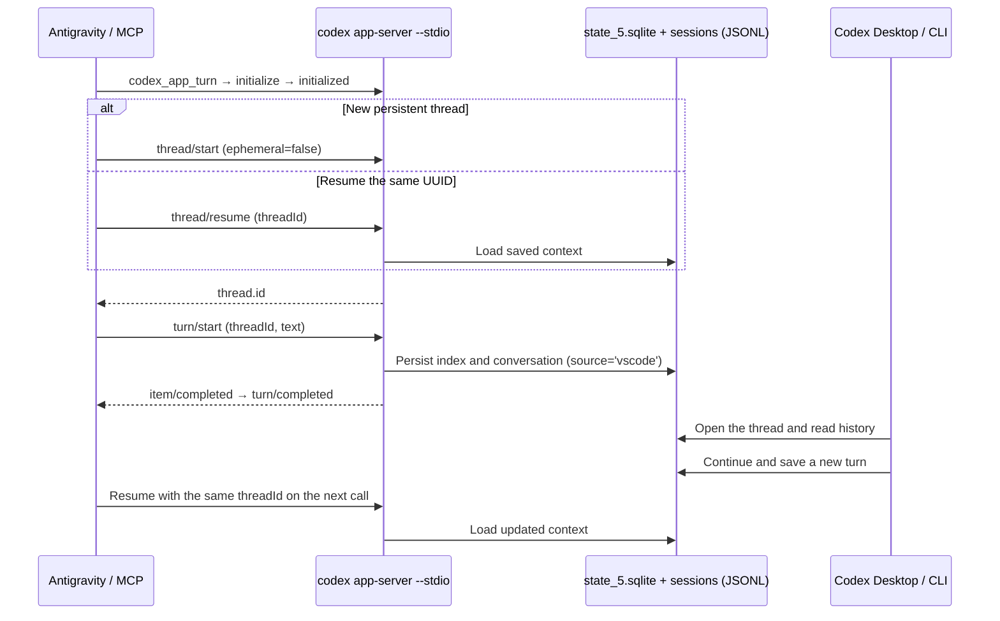
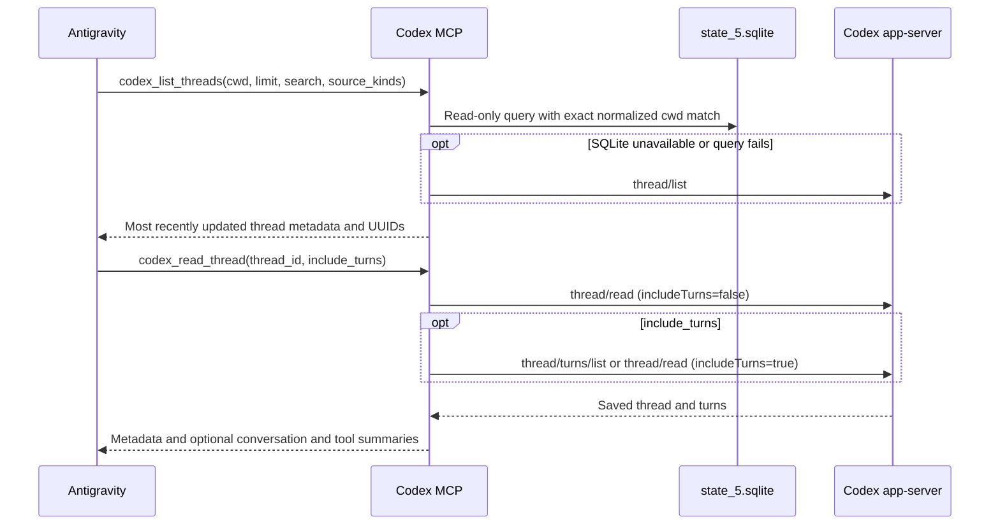

English | [简体中文](../README.md)

# Antigravity Codex Bridge

Antigravity plans, delegates, and reviews. Codex executes engineering tasks in the workspace. The MCP bridge sends individual turns and lets Antigravity find, read, and continue conversations created separately in Codex Desktop or the CLI.

<picture>
  <source media="(prefers-color-scheme: dark)" srcset="./images/architecture.svg">
  <source media="(prefers-color-scheme: light)" srcset="./images/architecture.light.svg">
  
</picture>

## Install the Antigravity plugin

You need Python 3.12+, a Codex CLI with App Server support, and working Codex sign-in or provider configuration. The launcher looks for `codex` on PATH and can also discover the `codex.exe` bundled with Codex Desktop on Windows.

```powershell
git clone https://github.com/khusdasz-cmd/antigravity-codex-bridge.git
cd antigravity-codex-bridge
python -m pip install .
agy plugin validate ./plugin
agy plugin install ./plugin
```

Use the Antigravity CLI (`agy`) to validate and install the local plugin, then start a new Antigravity session to load MCP. The plugin loader expands `${PLUGIN_ROOT}` to the installed plugin directory. Make sure `python` on Antigravity’s PATH is the interpreter you used to install the bridge. With `uv`, run `uv venv` and `uv pip install .`, then set the MCP `command` to the virtual environment’s Python executable. If you merge the MCP config into global settings manually, replace `${PLUGIN_ROOT}` with the absolute plugin directory. The plugin also includes collaboration rules and the `codex-collab` skill. [Antigravity plugin documentation](https://antigravity.google/docs/build-plugins/)

## MCP tools

| Tool | Parameters | Behavior |
| --- | --- | --- |
| `codex_app_turn` | Required `prompt` and `cd` (existing directory). Optional `thread_id=""`, `sandbox="read-only"`, `model=""`. | Starts or resumes a persistent thread. Returns `thread_id`, `turn_id`, `status`, and `reply`, plus `error` on failure. |
| `codex_list_threads` | `cwd=""`, `limit=20` (positive integer), `search=""`, `source_kinds=[]` (for example, `["vscode", "cli"]`). | Lists most recently updated threads first. Matches normalized `cwd` exactly and searches titles by case-insensitive substring. Empty filters match all values. |
| `codex_read_thread` | Required `thread_id` (UUID), optional `include_turns=true`. | Returns metadata and optionally user and assistant messages with concise tool summaries. |
| `codex` | Required `PROMPT` and `cd`. Optional `sandbox="read-only"`, `SESSION_ID=""`, `skip_git_repo_check=true`, `return_all_messages=false`, `image=[]`, `model=""`, `yolo=false`, `profile=""`. | Preserves the upstream interface with 100% backward compatibility. Runs `codex exec` and resumes via `SESSION_ID`. `image` accepts local image paths, `profile` selects a Codex configuration profile, `return_all_messages` returns the full event stream, and `yolo` bypasses approvals and sandboxing. |

Call `codex_list_threads` with your project directory, then pass a result’s `id` to `codex_read_thread`. To continue that conversation, pass the same UUID as `thread_id` to `codex_app_turn`. Both execution tools accept `read-only`, `workspace-write`, and `danger-full-access`. Use the read-only default for review and `workspace-write` for authorized edits. Leave `model` empty to use the Codex configuration.

## Protocol and shared sessions





The bridge starts an independent `codex app-server --stdio` child process. It exchanges UTF-8 JSONL on stdin and stdout, with one JSON object per line. Codex uses the JSON-RPC 2.0 message model and omits the `"jsonrpc":"2.0"` field. Requests carry `id`, `method`, and `params`. Responses echo the request ID with `result` or `error`. Notifications omit `id`. The handshake sends `clientInfo` with `initialize`, then sends `initialized` after success. `turn/start` returns a turn ID. The bridge matches notifications by thread and turn ID, then extracts the final assistant message once `turn/completed` arrives. The bridge sets `approvalPolicy="never"` and replies to interactive server requests with `-32601`. [OpenAI Codex App Server protocol](https://developers.openai.com/codex/app-server/)

The bridge starts and stops the child process on demand. It uses the current user’s Codex configuration, authentication, and persistent storage, so Codex Desktop can be closed. Session storage defaults to `~/.codex` and follows `CODEX_HOME`. The SQLite lookup also honors `CODEX_SQLITE_HOME` for the index directory. Both clients need access to the same session store for handoffs. `state_5.sqlite` indexes the threads, and the `*.jsonl` files under `sessions/` record their conversation events.

In Codex versions that support this sharing pattern, the App Server classifies newly created threads on this path as `source='vscode'`. Desktop recognizes that source as an IDE thread in its local list, so the thread can appear in the sidebar when both clients share the store and the thread matches workspace and archive filters. Codex records the source itself. Sidebar visibility depends on the Codex version and active filters. Alternate turns between clients so each new turn starts from the other client’s saved history.

## License and credits

- Extended from the MIT-licensed upstream project and retains 100% backward compatibility for the original `codex` tool interface. [GuDaStudio/codexmcp](https://github.com/GuDaStudio/codexmcp)
- The protocol and bidirectional subagent architecture draw on `@deepseek-ai/dsh-subagent-codex` in DeepSeek’s official project. [deepseek-ai/deepseek-harness](https://github.com/deepseek-ai/deepseek-harness)
- Thread mapping and bidirectional handoffs draw on the Relay plugin. [yangbobo2021/relay-dsh-plugin-codex](https://github.com/yangbobo2021/relay-dsh-plugin-codex)

The bridge extensions use the MIT license. See [LICENSE](../LICENSE).
